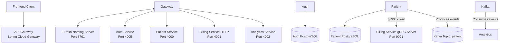
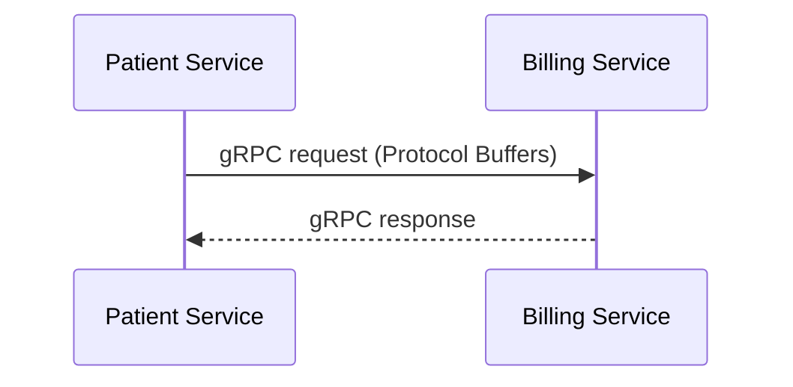
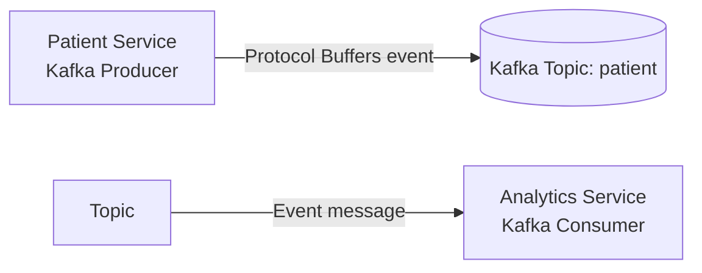
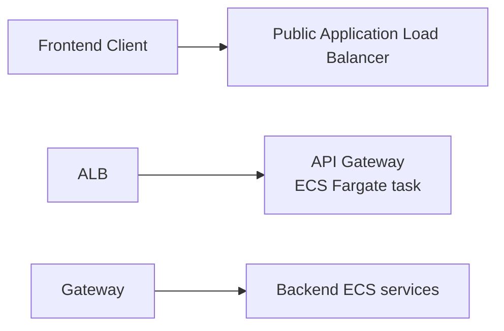

# Healthcare Microservices Platform

## 1\. Project Overview

The project is a distributed healthcare platform built with Spring Boot
microservices. It uses an API Gateway as the client-facing entry point,
Eureka for service registration and discovery in the Docker-based
environment, gRPC for synchronous service-to-service communication, and
Apache Kafka for asynchronous event-driven communication.

The platform contains the following application services:

1. **Patient Service** -- manages patient-related operations and
publishes patient events.
2. **Billing Service** -- provides billing functionality and exposes
both HTTP and gRPC endpoints.
3. **Analytics Service** -- consumes patient events from Kafka and
performs analytics-related processing.
4. **Auth Service** -- handles authentication and JWT token
generation/validation for secured API access.
5. **API Gateway** -- routes incoming client requests to the
appropriate backend service.

PostgreSQL is used for persistent data storage. The Auth and Patient
services have their respective databases in the described deployment
architecture.

## 2\. Architecture Views

This project has two useful architecture views:

* **Application / local Docker architecture:** shows the Spring Boot
services, Eureka Naming Server, API Gateway, PostgreSQL containers,
and Kafka running in the development environment.
* **AWS deployment architecture:** shows the cloud networking and
managed infrastructure represented in the architecture image below,
including the VPC, public Application Load Balancer, private ECS
services, RDS databases, and Amazon MSK.

The AWS diagram is a deployment view; it does not show every
application-level component. For example, Eureka is part of the
documented Docker application setup, while the AWS deployment uses the
service networking and discovery configuration defined for that
environment.

## 3\. Application Architecture --- Local Docker Environment



### Main application components

\---

Component                           Port / Mapping Responsibility

\---

API Gateway                                 `8765` Single entry point
for client HTTP
requests

Auth Service                       `4005` internal Authentication and
JWT handling

Patient Service                             `4000` Patient management
and Kafka event
production

Billing Service ---                         `4001` Billing HTTP
HTTP                                               endpoints

Billing Service ---                         `9001` Billing gRPC server
gRPC                                               endpoint

Analytics Service                      `4002:4002` Analytics and Kafka
event consumption

Eureka Naming Server                        `8761` Service registration
and discovery

Auth PostgreSQL                        `5001:5432` Auth Service
persistence

Patient PostgreSQL                     `5000:5432` Patient Service
persistence

Kafka                               `9092`, `9094` Asynchronous event
communication
---

**Port note:** Auth Service does not have a published host port in the
described Docker setup. Its internal port is `4005`, accessible to other
containers on the same Docker network.

### Eureka Naming Server

Eureka provides service registration and discovery in the Docker-based
application setup.

* Dashboard: `http://localhost:8761`
* Registry API: `http://localhost:8761/eureka/apps`
* Eureka URL for host-based applications:
`http://localhost:8761/eureka/`
* Eureka URL for containers on the same Docker network:
`http://eureka-naming-server:8761/eureka/`

Application         Eureka service ID       Instance port

\---

API Gateway         `api-gateway`                  `8765`
Auth Service        `auth-service`                 `4005`
Patient Service     `patient-service`              `4000`
Billing Service     `billing-service`              `4001`
Analytics Service   `analytics-service`            `4002`

### API Gateway routing

The API Gateway uses Spring Cloud Gateway, Eureka discovery, and Spring
Cloud LoadBalancer to route requests.

\---

Incoming gateway path     Discovery URI              Destination

\---

`/auth-service/\*\*`        `lb://auth-service`        Auth Service

`/patient-service/\*\*`     `lb://patient-service`     Patient Service

`/billing-service/\*\*`     `lb://billing-service`     Billing Service

## `/analytics-service/\*\*`   `lb://analytics-service`   Analytics Service

Example local gateway requests:

``` text
http://localhost:8765/auth-service/<endpoint>
http://localhost:8765/patient-service/<endpoint>
http://localhost:8765/billing-service/<endpoint>
http://localhost:8765/analytics-service/<endpoint>
```

## 4\. Inter-Service Communication

### Synchronous communication --- gRPC

Patient Service acts as the gRPC client and Billing Service acts as the
gRPC server.

* Communication uses gRPC and Protocol Buffers.
* The service contract is defined using `.proto` files.
* Patient Service invokes Billing Service over its gRPC endpoint.
* Billing Service exposes gRPC on port `9001`.



### Asynchronous communication --- Kafka

Patient Service publishes events to Kafka, and Analytics Service
consumes those events.

* Patient Service is the producer.
* Analytics Service is the consumer.
* Events are published to the `patient` Kafka topic.
* The producer and consumer share the Protocol Buffers message
contract.



This separates event production from event processing and allows
Analytics Service to consume patient events asynchronously.

## 5\. AWS Deployment Architecture

The following image represents the AWS deployment architecture for the
platform.

!\[AWS deployment architecture](aws-deployment-architecture.png)

### AWS architecture diagram --- component breakdown

\---

Layer                   AWS component           Role

\---

Entry point             Application Load        Public HTTP entry point
Balancer                that forwards requests
to the API Gateway
service

Networking              Amazon VPC              Provides an isolated
network for the
application
infrastructure

Public subnet           Application Load        Receives incoming
Balancer                client traffic

Compute                 Amazon ECS with AWS     Runs the containerized
Fargate                 application services

Container registry      Amazon ECR              Stores the Docker
images used by ECS
tasks

Database                Amazon RDS for          Hosts the Auth Service
PostgreSQL              and Patient Service
databases

Messaging               Amazon MSK              Managed Kafka cluster
used for patient events

Infrastructure as Code  AWS CDK and AWS         Defines and provisions
CloudFormation          the AWS infrastructure
---

### ECS services shown in the AWS architecture

The ECS cluster runs the application workloads as separate ECS
services/tasks:

* Auth Service
* API Gateway
* Patient Service
* Billing Service
* Analytics Service

The architecture places the ECS cluster and its service workloads in
private subnets. The public Application Load Balancer receives frontend
traffic and forwards it to the API Gateway.

### AWS data and messaging flows

**Client request flow**



**Database access**

* Auth Service connects to the Auth Service database hosted on Amazon
RDS.
* Patient Service connects to the Patient Service database hosted on
Amazon RDS.
* The RDS database layer is shown in private subnets.

**gRPC communication**

* Patient Service runs the gRPC client.
* Billing Service runs the gRPC server.
* Patient Service communicates with Billing Service over the internal
service network using the gRPC endpoint.

**Kafka event flow**

* Patient Service publishes patient events to the Kafka topic hosted
by Amazon MSK.
* Analytics Service consumes events from the same topic.
* The event contract uses Protocol Buffers.

### AWS infrastructure implementation

The AWS infrastructure is defined using AWS CDK in Java and deployed
through AWS CloudFormation. The infrastructure includes:

* A custom VPC with public and private subnets.
* An ECS cluster using AWS Fargate to run the microservices.
* Amazon ECR repositories for service container images.
* Amazon RDS PostgreSQL databases for Auth and Patient services.
* Amazon MSK for Kafka-based event communication.
* An Application Load Balancer for public access through the API
Gateway.

## 6\. Database Architecture

\---

Service                 Database                Purpose

\---

Auth Service            Auth PostgreSQL         Authentication-related
database                persistence

Patient Service         Patient PostgreSQL      Patient-related
database                persistence
---

The AWS architecture image shows both databases hosted by Amazon RDS in
a private subnet. In the local Docker setup, the database containers are
accessed through their published host ports.

## 7\. API Documentation

Each Spring Boot microservice exposes API documentation using **OpenAPI
and Swagger UI**. This provides service-specific API descriptions and
supports endpoint exploration and testing during development.

## 8\. Technology Stack

* **Language:** Java
* **Application framework:** Spring Boot
* **Gateway and discovery:** Spring Cloud Gateway, Spring Cloud
Netflix Eureka, Spring Cloud LoadBalancer
* **Security:** Spring Security, JWT
* **Persistence:** Spring Data JPA, PostgreSQL
* **Synchronous communication:** gRPC, Protocol Buffers
* **Asynchronous communication:** Apache Kafka, Protocol Buffers
* **Containerization:** Docker
* **AWS:** ECS Fargate, ECR, VPC, Application Load Balancer, RDS, MSK
* **Infrastructure as Code:** AWS CDK (Java), AWS CloudFormation
* **Testing:** JUnit integration tests
* **API documentation:** OpenAPI, Swagger
* **Development environment:** IntelliJ IDEA Ultimate

## 9\. Development Tools --- IntelliJ IDEA Ultimate

IntelliJ IDEA Ultimate was used throughout development as the primary
IDE, particularly for its integrated tooling:

* **HTTP Client:** Testing REST APIs directly from the IDE.
* **Docker integration:** Managing and monitoring containers and
images.
* **Kafka tooling:** Working with Kafka topics and inspecting
messages.
* **Database tools:** Connecting to PostgreSQL and running queries.
* **Development workflow:** Debugging, code navigation, refactoring,
and application run configurations.

## 10\. Java Language Features and Libraries

* **Java Records:** Used for concise data-carrier types and reducing
DTO boilerplate.
* **Streams:** Used for collection processing and transformation.
* **Optional:** Used to represent potentially absent values and make
null handling more explicit.
* **Project Lombok:** Used to reduce repetitive boilerplate code
across the services.

**Future enhancement:** Project Loom and Java Virtual Threads are
planned for exploration; they are not currently implemented in this
project.

## 11\. Testing

Integration tests are implemented using JUnit to validate application
functionality and service behaviour.

## 12\. Configuration and Networking Notes

* Eureka Naming Server runs on port `8761` in the local Docker
architecture.
* API Gateway runs on port `8765`.
* Patient Service runs on port `4000` and produces Kafka events.
* Billing Service exposes HTTP on port `4001` and gRPC on port `9001`.
* Analytics Service runs on port `4002` and consumes Kafka events.
* Patient Service communicates with Billing Service through gRPC.
* Analytics Service receives patient events through Kafka.
* Containers on the same Docker network should communicate using
service/container DNS names rather than `localhost`.
* Host applications can use `localhost` when the relevant container
port is published.
* In the AWS deployment view, the public Application Load Balancer
forwards traffic to the API Gateway running on ECS, while the
application services, RDS databases, and MSK cluster are shown
within the VPC's private networking.

